<p align="center">
  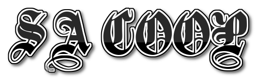
</p>

<p align="center">
  <a href="LICENSE"></a>
  
  
</p>

<p align="center"><b>Русский</b> · <a href="README.en.md">English</a></p>

> **Это издание с режимами: арена, танковое сражение и война банд Лос-Сантоса.** Сюжетный мод без них —
> [Farus256/sa-coop](https://github.com/Farus256/sa-coop). Собранные версии этих двух репозиториев друг к другу не
> подключаются.

SA:COOP - мод для GTA San Andreas, с которым сюжет можно пройти по сети вместе, от двух до шестнадцати игроков.
Один игрок становится хостом: игра идёт по его сохранению, и миссии запускает он. Остальные подключаются к нему
и играют в том же мире своими персонажами, со своими деньгами, навыками и внешностью.

## Отличия от оригинала

За основу взята оригинальная версия 0.2.7, всё из неё на месте. Что добавлено:

- до 16 игроков, число мест хост выбирает в окне F9 или в `coop\server.ini` (`max_players`, по умолчанию 4)
- чужие машины и прохожие появляются только рядом с игроком, а далёкие игроки обновляются реже, поэтому сеть
  и игра не захлёбываются
- подключение только по IP, а если не получилось, окно пишет конкретную причину (порт закрыт, сервер не отвечает,
  локальный адрес чужой сети, CGNAT у провайдера и т.д.)
- маркер миссии ждёт только тех, кто ближе 200 м, а `/go` начинает без остальных
- в катсцене рядом с CJ стоят до трёх напарников
- у каждого игрока свой цвет в чате, над головой и на радаре
- новые команды `/tp`, `/tphere`, `/go`, `/mute`, `/unmute`, `/draw`
- в меню есть все разрешения экрана, в том числе 1920x1080; полный экран по умолчанию — окно без рамки во весь
  монитор, поэтому ALT+TAB сворачивает игру сразу (`exclusive_fullscreen = 1` в `coop\coop.ini` возвращает
  настоящий полноэкранный режим с разрешением из меню)
- дальность прорисовки по умолчанию самая большая (`draw_distance` и `lod_distance` в `coop\coop.ini`, в игре `/draw`)
- метки игроков на карте видны всем, как метка в самой игре — чёрный круг с перекрестием: у хоста оно красное,
  у остальных зелёное, жёлтое, синее, розовое
- раненого игрока можно откачать: он 30 секунд лежит, напарник жмёт `E` и делает искусственное дыхание
- миссия хоста сажает напарников рядом в свою машину или ставит в кузов рядом с CJ
- лобби: друзья подключаются заранее, отмечают «Готов», хост нажимает «Начать игру»; каждый напарник прямо в лобби
  выбирает персонажа: CJ или боец Grove Street
- чит-коды можно вводить в чате (`/code HESOYAM`), и все видят, кто какой код ввёл и что он делает
- сцены миссий на движке игры (камера скрипта) напарники видят так же, как хост, и оказываются рядом с ним
- радио в машине выбирает водитель, пассажиры слышат ту же станцию; пассажир колесом мыши выбирает оружие
- новый снайперский прицел; чем больше игроков, тем точнее и многочисленнее враги
- товары у кассира 24/7 и у бармена с эффектами на время
- танковые сражения (`/tanks`): снаряды летят, у брони есть лоб и корма, танки NPC стреляют, солдаты с РПГ
- наземные сражения (`/arena якудза рандом 5`): волны врагов в интерьерах из миссий и босс в конце
  хост может отключить чит-коды у всех (`/cheats off`)
- в чате мышь: колесо листает историю, мышью выбираются сообщения, `Ctrl+C` копирует их
- режим «Война банд» в Лос-Сантосе: четыре банды игроков и компьютера, деньги, капты районов, покупки и победа по
  правилам хоста
- правки оригинального SA:COOP 0.3.0: совместные подработки, движения другого игрока, брандмауэр, точки начала
  миссий и перемены на карте в миссиях хоста, и его исправления; из 0.3.1: сцены на движке игры той же камерой,
  лоурайдеры и танец на пляже вдвоём, «Home Invasion» вдвоём, миссию может начать напарник, транспорт для
  напарника, пассажир с геймпада (общие навыки и своя война за территорию у напарника из 0.3.1 не взяты: навыки и
  статистика у каждого свои, войны начинает хост)
- сборка под Linux и macOS, автотесты сервера

С оригинальными версиями 0.2.x не совместимо, обновиться нужно всем. Игра втроём и больше пока почти не
тестировалась, если что-то сломалось, пришлите `coop\coop.log` в Issues.

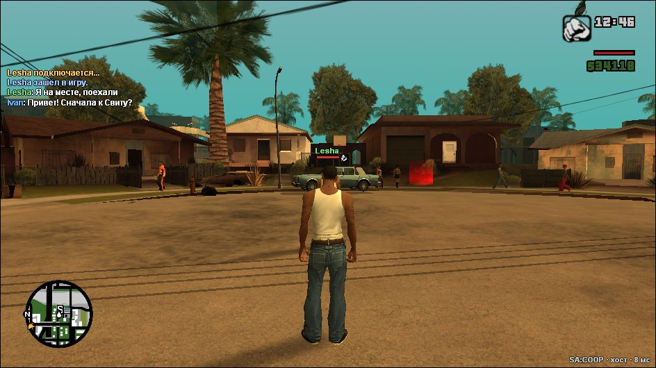

## Что умеет мод

### Сюжет вместе

Миссию запускает хост, но начинается она, только когда в маркер встали все напарники, которые рядом (или хост
написал `/go`). Напарник видит те же тексты,
субтитры, метки на радаре, маркеры, гоночные чекпоинты и таймеры, причём тексты идут на языке его собственной
игры. Реплики, которые персонажи говорят в миссиях вне катсцен, он тоже слышит. Оружие, которое миссия выдаёт
CJ, получает и напарник. Награду за миссию получают все. Враги нападают на всех, и ранить их может каждый.

| Хост стоит в маркере | Напарник видит, что его ждут |
|---|---|
| 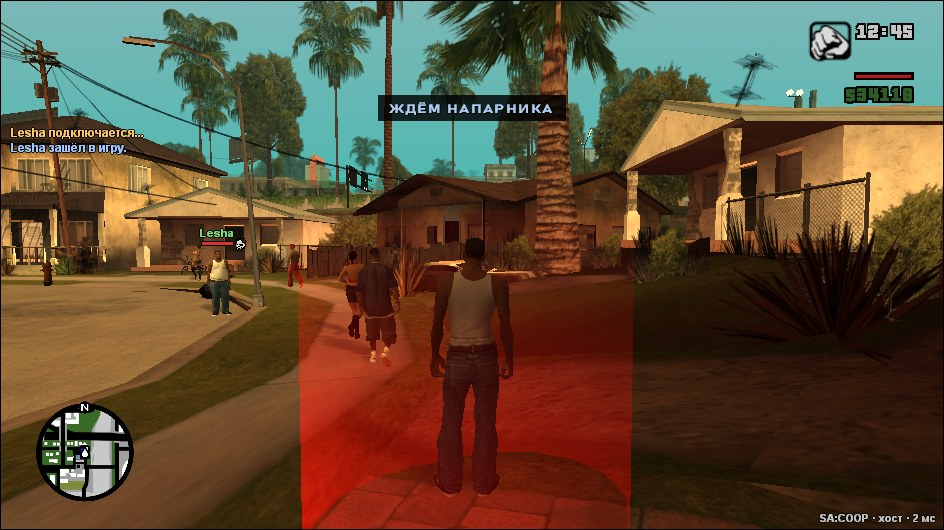 | 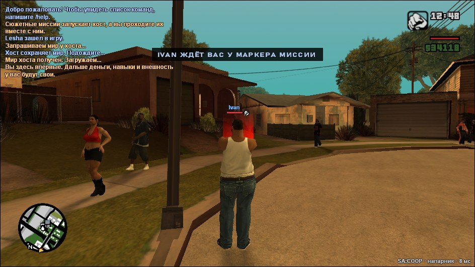 |

### Катсцены

Катсцены идут у всех одновременно, и персонажи напарников (до трёх) стоят рядом с CJ почти всё время, пока он в
кадре: каждая игра сама ставит их в кадр рядом с CJ, никого не закрывая, а когда CJ идёт, они идут рядом.

Сцены, которые миссия хоста показывает прямо в игре (камера скрипта, мир не останавливается), напарники видят с
той же камеры: тех, кто дальше 20 м, переносит к хосту (в его машину, если есть место), а управление на время
сцены отключается. Он слушает разговор,
переминается, кивает и смотрит на того, кто говорит, а когда CJ идёт, держится чуть позади и сбоку. Движения для
него взяты из анимаций самих катсцен. Пропустить катсцену можно только все вместе: один нажимает Enter, остальные
соглашаются тем же Enter или отказываются клавишей Esc.

| | |
|---|---|
| 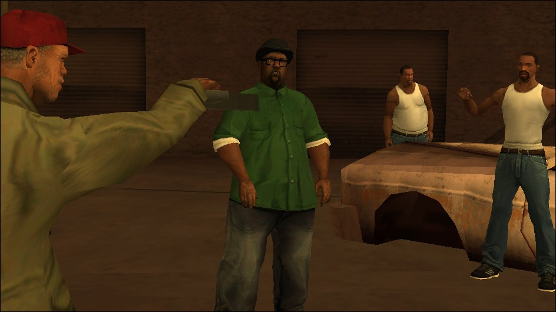 | 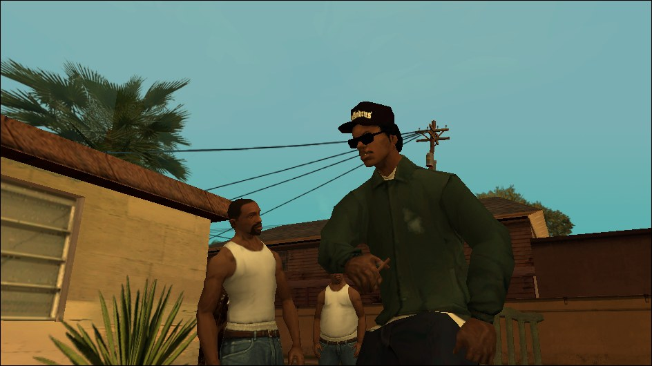 |
| 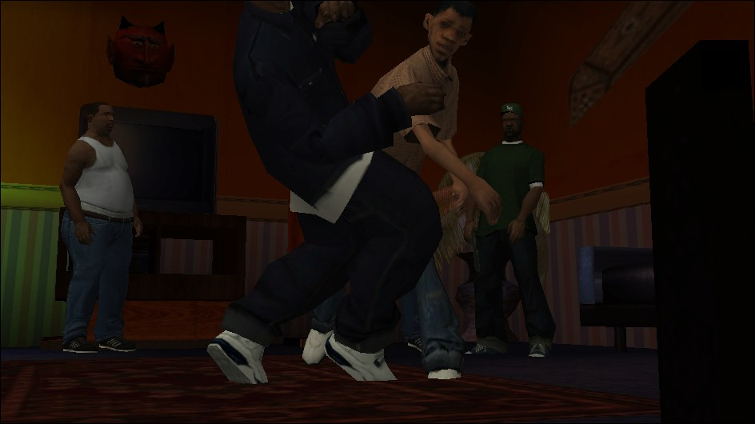 | 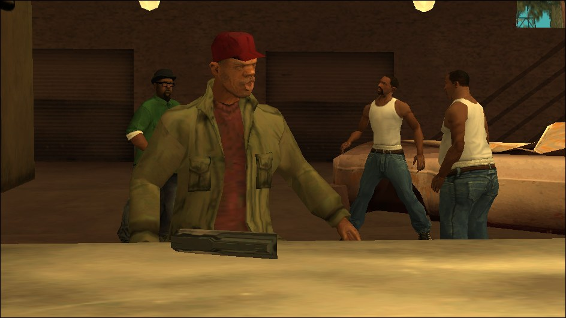 |

### Общий мир

У всех одни и те же прохожие, люди внутри зданий, машины и полиция, одинаковые время суток и погода. Прохожие
переговариваются и ругаются у всех одинаково, а полицейские заграждения с барьерами видны всем. Когда
один игрок уезжает, прохожие и машины рядом со вторым переходят в его игру и никуда не пропадают. Сбитые фонари
и знаки, разбитые стёкла и ящики, огонь, территории банд, двери зданий, которые открывает миссия, и ворота
Pay 'n' Spray и мастерских выглядят у всех одинаково. Подковы, устрицы, снимки и граффити засчитываются в общий
мир.

| У хоста | У напарника |
|---|---|
| 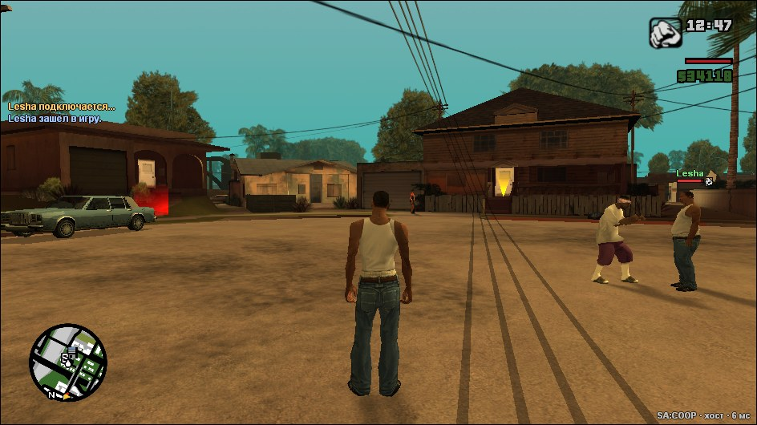 | 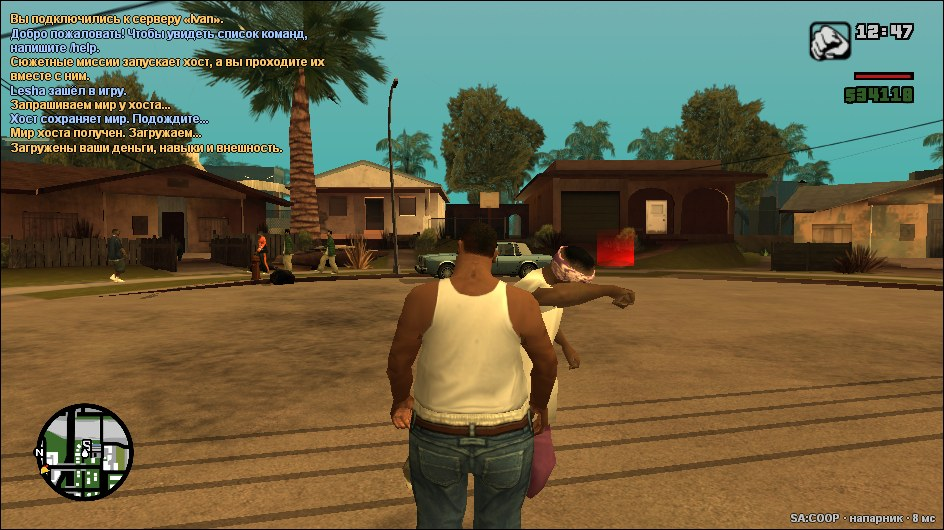 |

### Машины

Каждый водит сам или садится пассажиром к другому. Пассажир стреляет из окна: правая кнопка мыши высовывает
его с оружием, левая стреляет, колесо мыши выбирает оружие. Радио в машине одно на всех: станцию выбирает водитель,
пассажиры слышат её же и переключить не могут. Тюнинг и повреждения видны второму игроку. Работают шасси и сопла самолётов,
башни танка и пожарной машины, гидравлика, гудок, прожектор полицейского вертолёта, прицепы, эвакуатор и тягач
в аэропорту. Взрывы, ракеты, гранаты, выстрелы танка, вода из пожарной машины, стрельба NPC из машин, поезда
и радиоуправляемые модели видны всем. Оставить машину в гараже у дома может любой игрок, а хранит её мир хоста.

`G` сажает на ближайшее свободное пассажирское место, чья бы ни была машина. Когда миссия хоста сама сажает CJ
в машину, напарники ближе 200 м садятся на свободные места в ней. Когда миссия ставит CJ в кузов грузовика, напарники садятся в кабину, а кому не хватило места, встают в кузове рядом с CJ и стреляют по погоне
(слезть - `F`/`Enter`). Если CJ садится в машину сам, никого не зовут. Сюжетные действия остаются за хостом.

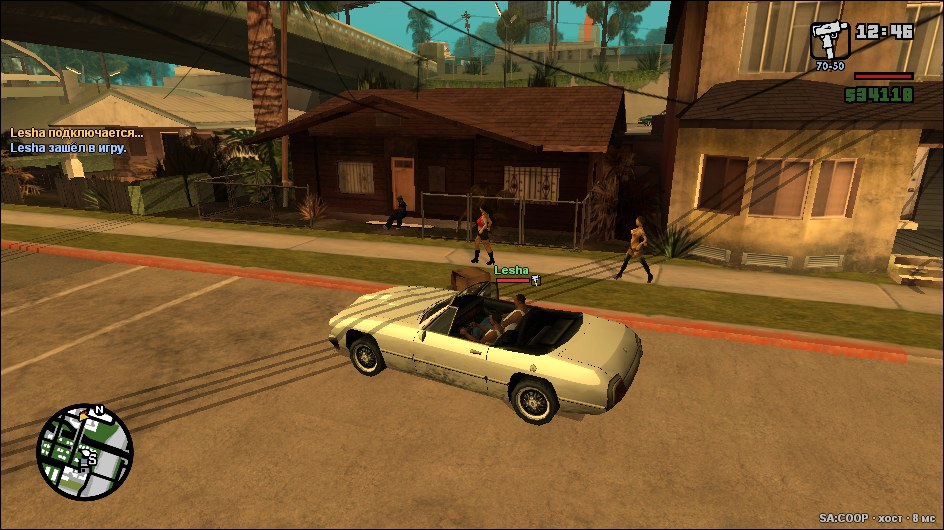

### Своя прокачка

Еда и спортзал, навыки оружия, одежда, стрижки, тату и деньги у каждого свои. Навыки вождения машины,
мотоцикла, велосипеда и самолёта общие: у обоих лучший из двух. Статистика в меню тоже общая. Подработка или
испытание, пройденные одним игроком, засчитываются обоим вместе с наградой.
Что игрок делает в закусочной, спортзале, парикмахерской или тату-салоне, второй видит у себя, как и поднос
с едой, сигарету, телефон у уха, прыжок с парашютом, стиль боя, выученный в спортзале, присед с кувырками,
перезарядку и проход в двери магазинов. Если игрок сменит модель персонажа, например скинселектором, второй
тоже увидит новую модель. Друг приходит в мир хоста своим CJ,
в той одежде и с теми тату, что у него в его игре. Если он подключился из главного меню, облик берётся из его
последнего сохранения. Когда хост сохраняет игру, прогресс друга сохраняется у хоста тоже. Уроки и медали
автошколы и других школ, уровни подработок, спортзал, уникальные трюки и бизнесы напарника остаются при нём и
после того, как мир хоста загружается заново.

| Хост видит напарника | Напарник видит хоста |
|---|---|
| 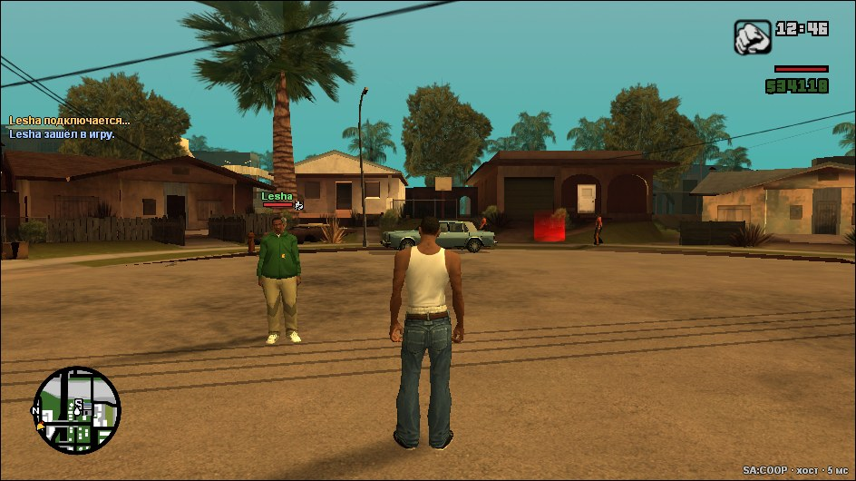 | 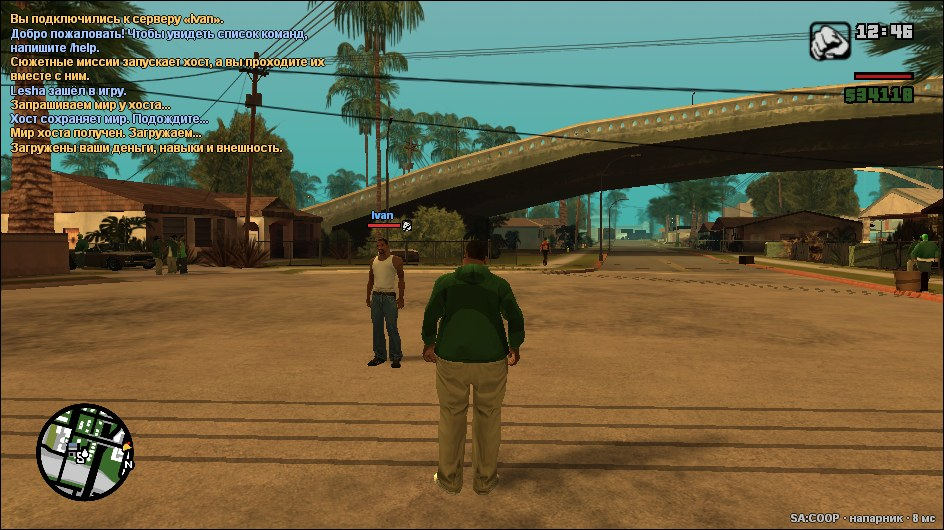 |

### Урон по напарнику

Хост может разрешить урон по напарнику галочкой в окне F9, перед тем как создать игру. Тогда игроки ранят
и убивают друг друга пулями, кулаками, взрывами, огнём и машиной. Без галочки они друг для друга неуязвимы,
и тихое убийство ножом со спины тоже не срабатывает.
Сбитый с ног игрок падает и поднимается на обоих экранах.

### Ранение

Если рядом (ближе 200 м) есть живой напарник, игрок с нулём здоровья не умирает, а падает и 30 секунд лежит на
месте; над ним видно, сколько осталось. Напарник подходит и жмёт `E`: 5 секунд делает искусственное дыхание, как
врач скорой, и раненый встаёт со всем своим оружием и половиной здоровья. Одного игрока можно поднять 2 раза за
6 минут, на третий раз он умирает сразу. Раненый может сдаться, удерживая `E`. В машине, в воде и когда рядом
никого нет, смерть обычная. Клавиша меняется в `coop\coop.ini` (`revive` в `[keys]`).

Пока игрок лежит, на него не обращают внимания ни прохожие, ни враги, ни полиция, а миссия хоста идёт дальше, пока
он не умер по-настоящему. Откачать может только игрок. Бандит из враждебной банды (Ballas, Vagos, Rifa) в радиусе
30 м подходит и добивает лежащего ногами: каждый удар отнимает 3 секунды. После смерти счёт
«2 раза за 6 минут» начинается заново. Лёжа, можно крутить камеру мышью.

| | |
|---|---|
| 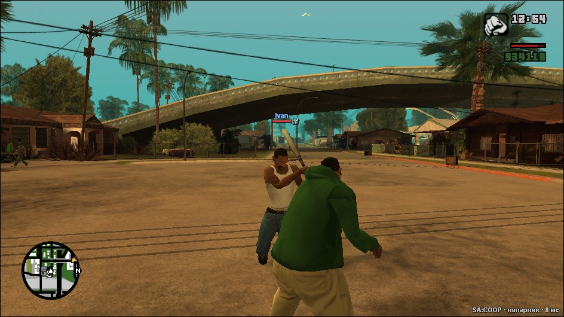 | 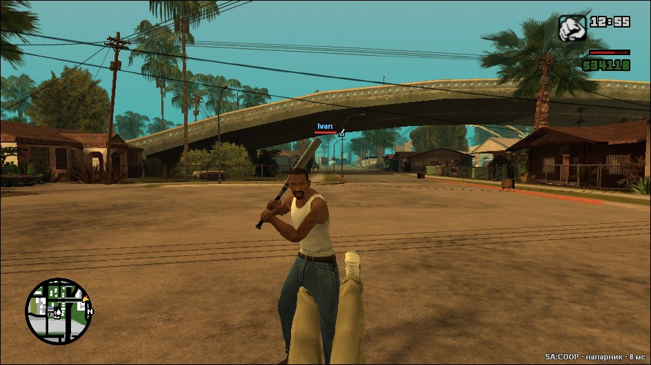 |

### Город

В обычных магазинах 24/7 и барах у кассира или бармена можно купить больше (`E` у прилавка, потом `1`-`4`), каждый
игрок покупает себе сам, кто бы ни зашёл первым:

| Товар | Цена | Что даёт |
|---|---|---|
| Выпивка | $50 | на 20 минут случайно: меткость, скорость или больше здоровья; каждые 4 минуты шанс 32% захмелеть на минуту |
| Еда | $25 | лечит полностью (в баре — закуска) |
| Газировка | $150 | на 30 минут: выносливость и чуть быстрее бег (только 24/7) |
| Сигареты | $250 | на 30 минут: меткость (только 24/7) |

Сколько ещё действует каждый эффект, видно справа на экране.

Взорванная инкассаторская машина рассыпает от $1 000 до $10 000, а встречаются они реже. Переходы в магазины
и дома и обратно быстрее.

Боец Grove Street, которого сделала игра другого игрока, вступает в банду того, кто его позвал (`G`), а не
хоста. Когда игрок заходит в здание, прохожие и машины его игры рядом с остальными игроками не пропадают у них,
а переходят к их играм.

### Танки

Пушка Rhino стреляет снарядом, который летит (250 м/с, немного проседает, до 750 м) и взрывается там, куда попал;
его видно в полёте. Перезарядка 4 секунды, внизу экрана видно, заряжено ли орудие и сколько осталось брони. Башня наводится туда,
куда смотрит камера, с поправкой на падение снаряда, а прицел на экране стоит там, куда снаряд упадёт (красный —
попадёт в танк). Пули и
взрывы танку по-прежнему не страшны, а снаряд пробивает броню: в лоб снимает около 18% прочности, в борт около 30%,
в корму около 45%. Танки, которыми управляют армия или полиция, сами наводят башню и стреляют по игроку с четырьмя и
больше звёздами розыска. Без урона по напарнику танки игроков друг друга не повреждают.

**Танковое сражение**: хост пишет `/tanks`. Каждый игрок ближе 400 м от хоста получает свой Rhino у дороги, а через
12 секунд с 250-350 м приходят три волны вражеских танков (столько, сколько игроков, и с каждой волной на один
больше; они подъезжают на 140 м и бьют оттуда, на радаре и на экране они отмечены красным). С каждой волной пешком идут солдаты с РПГ
(2, 3, 4): ракета снимает танку 30% брони. Следующая волна приходит, только когда уничтожены все танки и солдаты
текущей. Уничтожили все три волны — каждому
участнику $5 000. Если погибли все участники или прошло 15 минут, сражение проиграно. `/tanks join` — вступить,
подъехав позже, `/tanks stop` — хост заканчивает. Пока идёт сражение, у его участников нет прохожих и машин на
улицах: они пропадают и не появляются до конца боя. Враги всегда знают, где игроки.

### Наземные сражения

Хост пишет `/arena <враги> <место> <волны>`, например `/arena якудза рандом 5` или `/arena баллас притон 3`
(`/arena list` — все враги и места). Всех игроков переносит в интерьер из миссий: крэк-дворец Биг Смоука, особняк
Мэдд Догга, мясокомбинат (весь цех), мотель «Джефферсон», Либерти-Сити, полицейский участок, дамба
Шерман, стадион «Кикстарт», и большие: RC-полигон Зеро (`полигон`), стадион «Блад Боул» (`бладбоул`), департамент
планирования (`мэрия`), аэропорт Сан-Фиерро (`аэропорт`) (`рандом` — любое). Пока идёт арена, прохожих нет и музыки
места (стадионов и других) не слышно; упавшего под пол или за карту сразу возвращает на арену.
- RC-полигон: мод мельче размечает пол и не ведёт врагов через кочки и игрушечные домики выше колена; во время волн
  прилетают RC-вертолётики-камикадзе (по одному, до 3 сразу, за волну 2 + номер волны, но не больше 8) с дальнего
  края полигона; летят
  высоко (около 4 м) и быстрее бегущего человека к ближайшему игроку, вблизи пикируют и взрываются об него (небольшой
  взрыв, 3 м); два попадания сбивают вертолётик (с него $50); мини-боссы приезжают на квадроциклах и слезают метрах в 9
  от игроков (Офицер доезжает до своего места в тылу); в 20 м от точки появления игроков («базы») враги не появляются.
- Департамент планирования: играют только на верхних этажах. Все появляются на втором этаже (мод сам находит этаж
  над холлом), лестница вниз перекрыта заборами до потолка, враги появляются и ходят только наверху; упавший в холл
  возвращается наверх.
Враги: якудза, баллас, вагос, ацтекас, триады, мафия, рифа, байкеры, полиция, спецназ, армия. Волн от 1 до 10,
с каждой врагов больше, оружие лучше и стреляют точнее. Следующая волна — через 30 секунд
после того, как все враги текущей лежат; `/skip` (или `/arena skip`) начинает её сразу. В последней волне босс: Тенпенни, Пуласки, Эрнандес, Биг Смоук, Райдер, Оу Джи Лок, Ти-Бон Мендез,
Джиззи Би или Майк Торено — с АК-47 (бандиты) или М4 (полиция и Торено), а с ним без объявления его молчаливые
люди, которые обходят игроков; босс крепок, как спецназ: выстрел в голову не убивает его сразу. Враги идут отрядами
по 3-4 со всех сторон места, подальше от игроков и не оттуда, откуда шла прошлая волна (мод сам размечает пол места),
и не появляются в стенах. Страха у них нет, и они всегда знают, где игроки: не видя игрока, идут к нему по полу,
а не упираются в стены; увидев — бьют, прячутся за укрытиями, высовываются и стреляют, выжидают и всем отрядом идут
на игроков; застрявший враг сам выбирается. У отрядов есть гранатомётчики (бросают, только если граната долетит).
Ножевики приходят поодиночке и крадутся к спине игрока так, чтобы он их не видел (выжидают, пока игрок отвернётся),
бегают быстро (своей походкой, не CJ) и режут со спины с анимацией игры; у ножевиков модели их же силы. В двух последних волнах — снайперы: стоят далеко и стреляют оттуда, а потеряв игроков из вида, переходят на другое место. С каждой волной у врагов больше
брони (у спецназа вдвое меньше). Выходы из здания арены закрыты, пока она идёт, а броня после боя пропадает. На арене и в танковом сражении нет розыска, а подобранное там оружие после боя не остаётся.
Перед каждой волной, и перед первой тоже, по всему месту разложены немного оружия и бронежилеты — каждый раз в других
местах (где есть автоматы с газировкой, брони меньше). Денег за волны и за победу нет, потом всех возвращает туда,
где они стояли.
Погибли или вышли все — проиграно. `/arena stop` — закончить. Без сети арену можно пройти одному.

**Механики из CoD (враги — те же вооружённые группировки):**
- деньги — обычные деньги игры: с убитых врагов падают пачки денег (с особых больше), их надо подобрать; каждая
  новая арена начинается с $500 и бронежилетом (деньги прошлой арены не переходят; вне режима «Арена» деньги сохранения
  возвращаются после боя); выбывший теряет 10%; `Tab` — таблица: деньги, убийства и выбывания всех игроков (все игроки видны сразу);
- на каждой арене CJ как в начале игры: не толстый, не накачанный, выносливость, навыки оружия с нуля (вне режима «Арена» навыки сохранения возвращаются после боя) и
  медленно растут только с убийствами на арене (новичок, опытный, мастер: примерно 350-400 убийств до
  мастера); свой рост навыка от попаданий игра на арене не даёт;
- ящик с оружием ($950): над ящиком крутятся модели, выпавшее оружие ждёт 8 секунд, `E` берёт его; если в том же слоте
  уже есть другое оружие, подсказка пишет, что оно заменится; иногда выпадает кент с M4 (Олэг, Виталик, Дементий,
  Славик или Костя, имя над головой), который ходит за вами и стреляет по врагам (кента любого игрока ведёт
  игра хоста, поэтому он стреляет по настоящим врагам и у напарников); иногда плюшевый мишка (деньги возвращаются, ящик переезжает);
- ящик с одеждой рядом с ящиком оружия ($600): случайная вещь из всей одежды CJ (255 штук: верх, штаны, обувь, цепи,
  часы, очки и маски, головные уборы, костюмы). У каждой вещи свой бонус, и одна и та же вещь всегда даёт один и тот
  же: например, одна футболка даёт +25 брони каждую волну, другая урон по вам на 15% меньше, третья защиту от огня.
  Бонусы: +25 или +50 брони каждую волну, 125 или 150 здоровья, восстановление здоровья, бег без усталости, быстрая
  перезарядка (анимация перезарядки вдвое быстрее), +25% или +50% денег, +1 граната или молотов каждую волну, +1 обойма к оружию каждую волну, урон на 15%
  меньше, огонь или взрывы вдвое слабее, +5 здоровья или брони за убийство, навык оружия растёт вдвое быстрее, ящик
  с оружием на $200 дешевле, доски на баррикады бесплатно, у костюмов 150 здоровья и +50 брони; эффекты как в Brotato:
  25% шанс сразу забрать деньги с убитого, +$5 за убийство, 10% шанс +5 здоровья при попадании, 15% шанс обоймы за
  убийство, +5% ваших денег в начале волны (до $100), при здоровье ниже 25% урон по вам на 40% меньше, +$15 за убийство
  ценой +10% урона по вам, и другие. Название
  вещи и бонус пишутся в чате (название цветом редкости: синий, розовый или красный — редкость только для красоты). Вещи разных видов складываются, новая вещь того же вида заменяет старую; после арены
  CJ снова в своей одежде; ящики не сдвинуть и не сломать выстрелами;
- баррикады строят игроки (`H`, $300, до 12) или хост сохраняет свои (`/arena баррикада`); враги ломают доски,
  `E` у баррикады прибивает доску ($10); между волнами сквозь баррикады можно проходить;
- огнемётчик, близнецы, медики и босс роняют бонус для всех: патроны или здоровье;
- ящик с оружием на особняке, притоне, участке, мотеле, дамбе, мясокомбинате, RC-полигоне, департаменте,
  Либерти-Сити и «Кикстарте» по умолчанию стоит на выбранном игроками месте (у всех, без файла); свои места хоста:
  `/arena ящик`, `/arena баррикада`, `/arena сброс` (хранятся в `coop\arena-spots.ini` и важнее мест по умолчанию);
- чувствительность мыши по вертикали такая же, как по горизонтали;
- на арене не умирают и не попадают в больницу: выбывший становится зрителем (камера за напарником, мышь вращает её
  вокруг него, ЛКМ — другой напарник),
  в начале следующей волны возвращается с пистолетом; враги у всех остаются на месте, даже если выбыл хост;
- на полу бесплатно лежат только пистолеты, пистолеты с глушителем, биты (немного) и бронежилеты; оружия на стенах нет;
- между волнами: `Y` пропустить ожидание, `/arena смена` сменить арену (волна, оружие и деньги остаются);
- оружие без патронов не пропадает; с обычных врагов редко падают патроны; `J` кладёт оружие из рук для напарника
  (если у напарника в том же слоте другое оружие, он берёт его по `E`);
- у каждого врага не больше 3 гранат, у огнемётчика 2 коктейля Молотова (бросает с 8-15 м, и через низкие укрытия);
- ножевики появляются вместе с отрядом, не ближе 9 м от игроков и не за спиной; удар ножевика в спину на арене не
  убивает, а кладёт раненым (или делает зрителем, если откачать некому), в больницу не отправляет;
- `/arena баллас притон бесконечно`: волны без конца, босс каждые 10 волн, 5-я (15-я, 25-я…) — сложная (врагов в 1,5 раза больше, они на 30% крепче); слова можно писать в любом порядке;
  между волнами 30 секунд; огонь гаснет быстрее.

**Сборка 30:**
- у напарников арена тоже с нуля (режим «Арена» передаётся с началом арены); маркеров нет ни в доме CJ, ни на арене;
- деньги на полу лежат до конца арены; плюшевого мишки в ящике нет; спецназ на арене как остальные силы;
- поднятый медиком враг встаёт с анимацией; за убийство оружием ближнего боя денег вдвое больше;
- все лежат (ранены или выбыли) — арена сразу проиграна, раненые встают, все в доме CJ;
- у ящика: радио (`E` — следующая станция игры, только у себя; ещё раз после последней — выключить) и автомат
  с газировкой (`E`, $10 — CJ пьёт банку, +20% здоровья; не больше 2 раз в минуту);
- нажмите `H`: перед вами голограмма баррикады (видна только вам); ещё раз нажмите `H` — голограмма убрана;
  зажмите `H` на 1,5 с там, где её можно поставить, — баррикада построена;
- после каждой волны справа окно «MVP — лучший игрок волны» в стиле меню GTA SA: у кого больше всего убийств за волну
  (при равенстве — кто реже падал);
- на арене время стоит (полдень), погода одна, радара нет; между волнами сверху полоска из 10 волн до следующего босса (сложная волна отмечена оранжевым, в конце — имя босса);
- с одним игроком врагов в волне на 30% меньше, с двумя — на 15%;
- справа список клавиш, слева сверху подсказки в окне как в игре (например, про деньги за убийство холодным оружием);
  выключить их: галочка «Подсказки на арене» в F9 или `/подсказки`;
- рядом с ящиком оружия ящик навыков ($300): случайно жир, мускулы, выносливость или навык одного оружия (+5..25%);
  ящик одежды теперь картонная коробка; в ящике оружия у всех пушек равный шанс;
- у врагов нет брони: она добавлена к их здоровью; оружие из убитых не выпадает; вражеские гранаты взрываются на 1,5 с позже;
- Мясник перед рывком останавливается, поднимает пилу и ревёт мотором 1,8 с; медик держится позади своих, его газ лечит
  сильнее;
- оператора дронов больше нет: вертолётики на RC-полигоне прилетают сами;
- **Торговец**: после 5-й волны, потом после 15-й, 25-й…: когда кончается пауза, никто не приходит («Но никто не пришел.»),
  приходит торговец (короткая сцена для всех: камера следит, как он входит); `/торговец` — откуда он приходит, `/торговец цель` —
  куда идёт и где торгует (по умолчанию к ящику), `/торговец сброс` — забыть оба; `/spawnmerchant` — вызвать сейчас (хост); минута на покупки
  (или `Y` всех). `E` у него — окно с вкладками «Броня», «Гаджеты», «Модификации»: W/S или стрелки — выбор, A/D — вкладка,
  Enter, Пробел или клик — купить, Esc/E — выйти:
  - броня (одна): Джаггернаута ($1200: держит на 50% больше, обоймы больше, чуть медленнее), Поджигателя ($1300: огонь не
    жжёт, +2 молотова и +200 к огнемёту каждую волну, медленнее), Солдата ($1000: быстрее, точнее и дальше, броня держит на
    25% меньше); работает, пока есть броня; полоска брони игры окрашена в цвет брони;
  - гаджет на `X` (один): визор копа ($3000: враги видны сквозь стены, все пули — в голову ближайшего видимого врага; заряд 3%/с, +3% за убийство), рейдж-доза ($1300:
    укол, 3 с судорог, потом RAMPAGE — 200 HP, быстрее, точнее, удары вдвое сильнее, 25 с; раз в 2 волны; можно лёжа раненым),
    пульт «Shahed» ($700: свой RC-вертолётик, взрыв о врага или пол; новый заряд — 2 груды хлама со сбитых дронов, а где дронов нет — с 10% врагов);
  - модификации: подствольник на любое оружие ($500, `N`), штык-нож ($300, `N` рядом с врагом: урон и враг на полу),
    магазины «Спарка» ($150: каждая вторая перезарядка быстрая);
- последние 3 врага волны через 6 секунд отмечены красными стрелками (видны сквозь стены);
- боссы: половина с катаной, половина с обычным АК-47; с катаной: подбегает, замахивается и крутится,
  надвигаясь на игрока (кого достанет — минус половина здоровья и брони), пока крутится, пули от него отскакивают;
  рывок с бензопилой в него в это время оглушает его на 4 с; с него выпадает катана, с босса с АК — его АК;
- с Мясника падает бензопила: держите `N` — заряд рывка, видна траектория (до 14 м), отпустите `N` — рывок (6 рывков на одну бензопилу), все враги на пути
  гибнут; рывок раз в 3 с;
- RC-полигон: вертолётики прилетают сами (в первой волне 1 вертолётик,
  дальше до 3 за волну, не больше 3 сразу);
- оружие из врагов не выпадает, кроме огнемётчика (его огнемёт), Мясника (бензопила) и боссов;
- подобранные деньги справа сверху — цифрами и цветом денег GTA SA;
- крэк-дворец: каждую волну враги атакуют следующую зону (на зону 1 они идут от самого входа) (метка «ЗОНА N» видна сквозь стены): сначала бегут к ней;
  враги появляются у атакуемой зоны; строители без оружия (с них $150) ставят у зоны свои баррикады (на ваших местах
  `/arena стройка`, если они есть); их баррикады ломаются: пули, удары, взрывы, рывок бензопилы насквозь;
  зоны мод выбирает сам или берёт ваши;
- свои точки места (стоя там, во время арены в этом месте): `/arena спавн` — где появляются игроки, `/arena враги` —
  точка появления врагов (до 8; враги тогда появляются только у них), `/arena зона` — зона (до 4), `/arena стройка` — место баррикады строителя
  (до 16; забор встаёт поперёк вашего взгляда, строитель берёт свободное ближайшее к атакуемой зоне), `/arena радио` и `/arena газировка` — поставить радио или автомат с газировкой
  здесь (радио до 4, автоматов до 2; без них по одному стоят у ящика; `/arena <вид> сброс` — сбросить по отдельности все точки одного вида:
  `ящик`, `спавн`, `враги`, `зона`, `радио`, `газировка`, `баррикада`, `стройка`; точки по умолчанию тогда снова действуют); всё хранится в
  `coop\arena-spots.ini`, `/arena сброс` забывает; игроки появляются сразу на своей точке появления. У притона (точка появления, 4 зоны, 10 мест строителя) и мотеля (точка появления, 2 точки врагов, радио и автомат), а у RC-полигона радио и автомат такие точки есть у всех по умолчанию; свои точки того же вида их заменяют; `/arena где` — показать свои координаты.

**Прицеливание:** мода imCamAim в сборке больше нет. Кто ставил прошлые сборки, удалите из папки игры
`imCamAim.SA.asi` и `aimingSets.dat`.

**Режим «Арена»** (F9 → «Создать игру» → «Режим: Арена» → «Создать арену»): всегда новая игра без пролога, сохранение
не нужно. Хост выбирает врагов, место и число волн; друзья заходят по IP, хост жмёт «Начать игру» в лобби. Все ждут в
доме CJ (без маркеров и выхода), через 15 секунд арена начинается сама, после неё (победа или поражение) все снова в
доме CJ, и через 20 секунд начинается следующая. В окне F9 хост может поменять врагов, место и волны для следующей
арены или нажать «Начать арену сейчас». На арену все идут за CJ и с пистолетом, одежду даёт её ящик.
На арене пропадают значки сохранения в домах; в домах и других помещениях можно бегать спринтом.

**Ти-Бон Мендез** (босс) — АК-47 с подствольным гранатомётом: стреляет из автомата и время от времени из подствольника
(снаряд летит дальше гранаты и взрывается сразу при попадании), после выстрела убегает в тыл перезаряжаться 4 секунды
и возвращается. С него падает этот АК-47 с подствольником: `N` — выстрел (АК-47 в руках), повторное `N` — зарядить
гранатой из инвентаря. Хост может вызвать его для проверки: `/arena тибон` (во время арены).

**Мини-боссы:** «Близнецы» Отто и Эрнандо; «Мясник» с бензопилой (525 здоровья: заводит пилу и несётся по прямой до
стены, о стену оглушается на 4 секунды, кого заденет — того кладёт раненым, не останавливаясь, баррикаду на пути
сносит целиком и бежит дальше; при 100 здоровья и меньше отскакивает от стены к стене); «Офицер» с катаной (450 здоровья и броня: сидит в дальнем тылу — к нему надо добраться,
каждые 30 секунд зовёт 4 бойцов, раненый отступает, без урона восстанавливает здоровье, отмечен сквозь стены). Медик
один раз бросает зелёную лечебную гранату (лечит своих в облаке; раненые свои в 20 м сбегаются к ней и стоят
в облаке, отстреливаясь, пока не вылечатся или облако не рассеется), с медика с шансом 35% падает бонус. С шансом 10%
волна состоит только из 4 огнемётчиков (кроме мотеля и мясокомбината). На мотеле вместо этого событие «бейсбольная ярость» (15% со 2-й волны,
не в волну босса): все враги волны с битами появляются сразу в двух точках и бегут на игроков, ломая баррикады на пути.
Враги, когда игрок выше или ниже их (на другом этаже), идут к нему по лестницам, а не стоят под ним. Враг, оказавшийся дальше 300 м от всех игроков, появляется снова на арене. Ножевики бегают быстрее и приходят вместе с отрядами (на мотеле ножевиков нет). В волне с Мясником обычных врагов меньше (примерно 60%). Огнемётчик — не в каждой волне
(с 3-й, примерно в трети волн). Со всем огнестрельным оружием можно ходить во все стороны, целясь и стреляя. Ящик с оружием звучит при прокрутке.

**Новые противники:** огнемётчик у байкеров и вагос (250 здоровья и немного брони, приходит без объявления, медленно идёт,
бронежилет на теле, его не сбить с ног и не оглушить, жжёт огнемётом со средней дистанции — его огонь жжёт слабее,
коктейли Молотова издалека); медики, огнемётчики и остальные классы теперь у всех врагов — лечат своих в
радиусе 5 м на 20%, в первую очередь бегут к павшим и раненым, поднимают до 5 павших; мини-босс «Близнецы»
(разные модели, по 50 здоровья, имена над головой вблизи: Отто с двумя обрезами, Эрнандо с двумя Desert Eagle); враги спринтуют, когда далеко.
Оружия у врагов и на полу стало больше (глушитель, Tec-9, обрез, винтовка, катана, бензопила, огнемёт и др.).

**Броски и перезарядка (во всём моде):** с гранатой, слезоточивым газом или «молотовым» зажмите ЛКМ — видна траектория
и место падения, чем дольше держите, тем дальше; отпустите — бросок. Взрыв гранаты или ракеты не ранит игрока за стеной. `R` — перезарядить неполный магазин.

### Война банд (Лос-Сантос)

Отдельный режим, который хост выбирает при создании сервера (F9 → «Режим: Война банд: ЛС»). Вместо сюжета все
начинают новую игру без пролога и миссий, а территории Лос-Сантоса такие, как в начале игры. В лобби каждый
нажимает на свою банду: Grove Street Families, Баллас, Лос-Сантос Вагос или Варриос Лос Ацтекас (в одной банде может
быть несколько игроков, первый из них — лидер). Банду, за которую никто не играет, хост в лобби оставляет компьютеру
или убирает из игры (тогда её районы ничьи): на карточке каждой банды есть кнопка «Бот: ВКЛ / ВЫКЛ». Там же хост выбирает победу: все районы, заданное число районов или
больше всех районов за заданное время. На капты не приезжают полиция, скорая и пожарные: рядом с каптом (250 м) не
дают розыск, а уже полученный снимается.

Игроки появляются на базе своей банды в её одежде (лидер — Свит, Биг Смоук, Райдер или Сезар) и с её оружием и
после каждой смерти или ареста появляются там же, а не в больнице. Свои уличные бандиты уважают игрока, чужие
ненавидят, игроки разных банд ранят друг друга. Районы на карте и радаре закрашены цветом банды-хозяина, как в
сюжете (атакуемый мигает), вся карта открыта с начала. Прохожих и машин на улицах чуть меньше обычного; входов в здания с жёлтыми метками (парикмахерские, магазины одежды и
другие) и разбросанного по городу оружия нет. Возле базы по тротуарам гуляют 5-10 людей банды (больше с уровнем оружия),
погибший сменяется через 90 секунд. Своих уличных бандитов можно брать к себе в группу (`G` перед ним или с захватом
цели). Игроков чужих банд не видно на радаре. Лидер банды видит на радаре хату банды, а лидер Grove Street — ещё и
Эммета. Клавиша F1 в игре ничего не делает. У всех игроков в войне максимальный авторитет. У каждой базы свой вход в дом — кольцо цвета банды у двери ближайшего дома (или у
самой базы, если дома рядом нет), входят только свои. Каждая банда производит товар на $200 раз в 6 минут; деньги лежат в
банке банды, а тратит их любой её игрок в меню F5 (или `/gang`):

| Покупка | Цена | Что даёт |
|---|---|---|
| Капт территории | $500 | поставьте метку на район на карте и купите: туда едут 4 машины ваших бойцов; хозяева защищаются двумя волнами, район ваш, когда защитники лежат, ваши ещё там, а игроков других банд в районе не осталось (их надо убить). Одновременно идёт не больше двух каптов, и у разных банд |
| Бронежилеты | $200 | покупаются один раз и навсегда: броня игрокам банды при каждом появлении и всем её бойцам, нынешним и новым |
| Подкуп полиции | $550 | полиция 5 минут охотится на банду района под меткой (или где вы стоите) |
| Улучшение производства | $1000 | товар производится быстрее |
| Улучшение качества | $1000 ($2000 после производства) | товар стоит вдвое дороже |

Особенности банд. **Grove Street**: первые 4 капта стоят $150 (едут 3 машины), подкуп полиции $700, у Эммета можно
бесплатно взять броню, а один раз — и улучшение оружия. **Баллас**: подкуп полиции $350, банда крышует магазины 24/7,
бары и клубы на своих районах (+$50 с каждого к товару), но чем больше продано товара, тем хуже стреляют её бойцы.
**Вагос**: производство $600, качество $1000, товар продаётся быстрее, бойцов больше, но у них мало здоровья и
меткости. **Ацтекас**: самые меткие бойцы, на капт едут на мотоциклах по двое и стреляют с них.

Оружие у банд растёт по уровням (у Баллас их три, у остальных четыре): от пистолета или дигла до АК-47, М4, МП5,
гранат и коктейлей Молотова. Время от времени в городе появляется военный конвой: банда, чей игрок пригонит его
грузовик на свою базу, получает оружие следующего уровня; вверху экрана пишется, сколько до него метров (а за рулём —
сколько до базы). Банда без районов выбывает. Перехват сделок, контрабанда,
режимы Сан-Фиерро и Лас-Вентураса и C.R.A.S.H. будут позже.

### Русский и английский

Окно SA:COOP, чат и подсказки есть на русском и английском. Язык переключается вверху окна F9, и каждый
выбирает его себе сам: у хоста может быть русский, а у напарника английский.

| У хоста | У напарника |
|---|---|
| 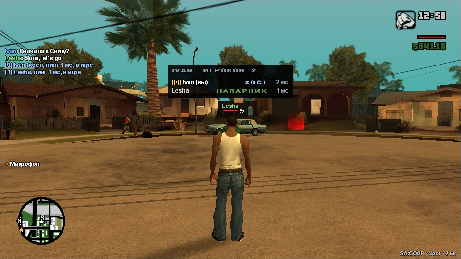 | 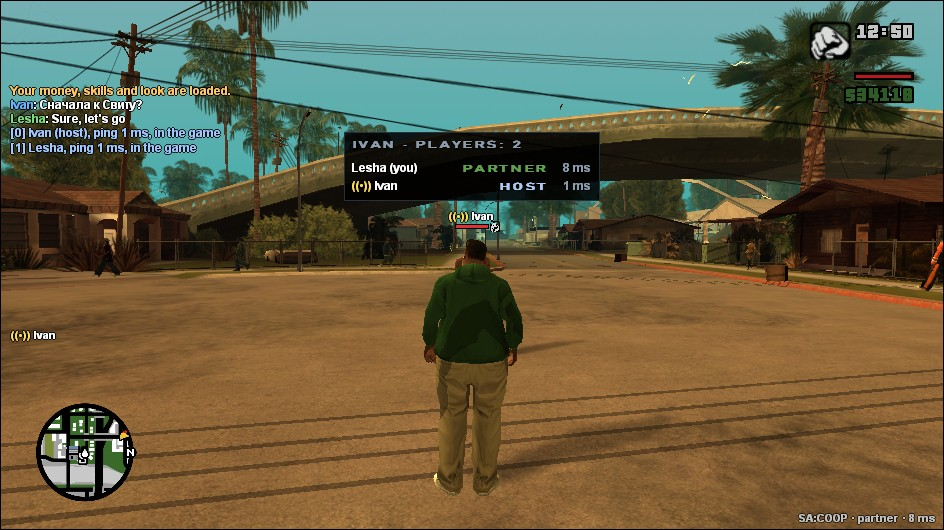 |

### Остальное

Подработки (такси, скорая, пожарные, полиция, сутенёр), гонки, школы, тир, грузоперевозки и карьер каждый
проходит в своей игре. Подработку или гонку можно пройти вдвоём: в первые 20 секунд после её начала нажмите Y,
и остальным игрокам придёт приглашение (Y — да, N — нет; присоединиться может один). Согласившийся видит её метки, чекпоинты, таймеры
и подсказки, может ехать рядом и помогать, например тушить машины или стрелять по преступникам, а в конце получает
столько же денег. Уровни подработки остаются у того, кто её начал, а награду за полное прохождение получают оба. Есть текстовый чат и голос, причём чем дальше напарник, тем тише его слышно. Метку на
карте второй игрок видит у себя на радаре, а купленный дом появляется у обоих. Над головой напарника видны его
здоровье, броня, оружие и звёзды розыска. Войну за территорию начинает хост, а провоцировать её убийствами
бандитов можно вдвоём. Чит-коды на погоду, трафик, прохожих и скорость игры действуют у обоих, а на оружие,
деньги и здоровье только у того, кто их ввёл. Кто какой код ввёл и что он делает, пишется в чате у всех.

Игроки и NPC, которые стоят на
крыше или в кузове едущей машины, у других стоят там же, а не волочатся за машиной.

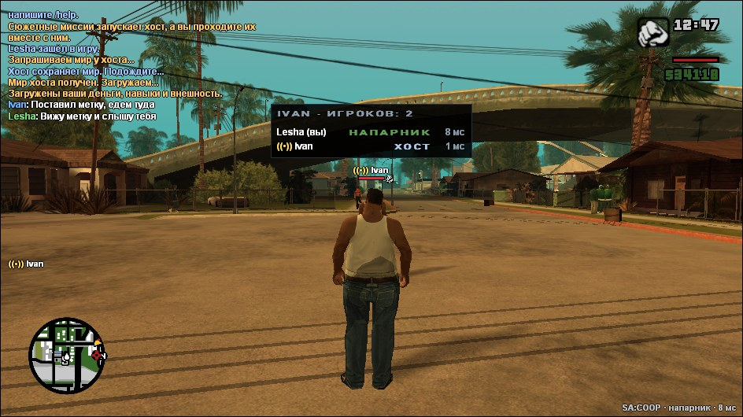

## Установка

Нужна GTA San Andreas версии 1.0 US, чистая или сборка с модами. Если игра куплена в Steam или Rockstar Games
Launcher, её сначала надо откатить до 1.0 US, например программой GTA SA Downgrader.

1. Скачайте архив `SA-COOP.zip` со страницы [Releases](../../releases) и распакуйте его в папку игры, чтобы
   `coop.asi`, `install.bat` и папка `coop` оказались рядом с `gta_sa.exe`.
2. Запустите `install.bat`. В чистой игре он поставит загрузчик ASI-плагинов, а в сборке, где загрузчик уже
   есть, ничего не изменит.
3. Запустите игру. Окно SA:COOP откроется в главном меню, а потом его можно вызвать клавишей F9. Впишите ник.

Подробная инструкция для игроков лежит в архиве в файле `Инструкция.txt`.

## Как играть

Хост нажимает F9, открывает вкладку «Создать игру», выбирает сохранение, число мест («Игроков: до N», 2–16)
и нажимает «Создать сервер». Если он уже в игре, сервер создаётся из текущей игры. Галочка «Урон по напарнику»
разрешает игрокам ранить друг друга. Через пару секунд в окне появится внешний IP с портом, например
`85.12.34.56:7788`, и кнопка «Скопировать». Его нужно отправить друзьям. Если хочется закрыть сервер от посторонних,
задайте пароль.

Друзья на вкладке «Подключиться» вписывают этот адрес и нажимают «Подключиться». Порт можно указать прямо в адресе
через двоеточие или в поле «Порт». Если хост создал игру из главного меню, все попадают в лобби: друзья жмут
«Готов», а хост — «Начать игру», и мир загружается у всех. Кто подключится позже, сразу входит в игру. Если сервер
создан из уже идущей игры, лобби нет.

Каждый напарник прямо в лобби выбирает персонажа: посередине меню готовности, справа окно с персонажем, под ним
стрелки. CJ или один из бойцов Grove Street; кто стрелки не трогал, играет тем, кем играл в этом мире. Выбор
сохраняется у хоста. Новичок, подключившийся уже после начала игры, играет за CJ. Персонаж,
который не CJ, не может зайти в магазины одежды, парикмахерские и тату-салоны (переодеть его игра не может) и не
говорит репликами CJ.

Язык переключается вверху окна, там, где RU и EN.

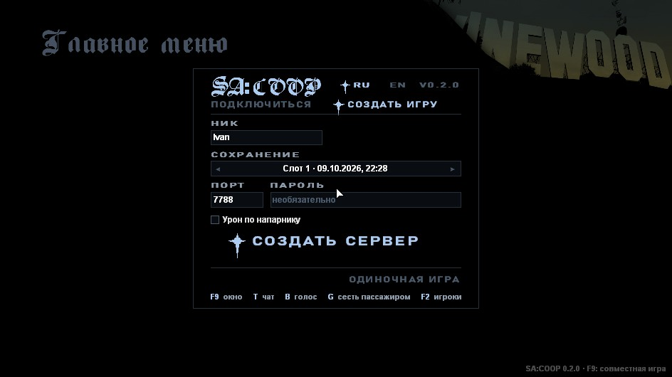

Сюжет можно начать и с самого начала: последний пункт в списке сохранений называется «Новая игра». Пролог хост
проходит один, а друг подключается сразу и ждёт. Когда CJ сядет на велосипед, друг появится рядом с ним, и для
него тоже найдётся велосипед.

Сервер сам пробует открыть UDP-порт на роутере через UPnP, и окно F9 у хоста показывает, получилось ли. Если нет,
порт (по умолчанию 7788/UDP) нужно пробросить на роутере вручную. Если провайдер держит хоста за CGNAT, окно тоже
об этом скажет: тогда из интернета подключиться нельзя, нужен белый IP или VPN вроде Radmin или ZeroTier
(с ним друзья подключаются по адресу из VPN).

Когда хост создаёт игру, мод проверяет брандмауэр Windows. Если тот не пустит друзей к серверу, Windows спросит
разрешение на изменения, и после «Да» мод разрешит `coop-server.exe` во всех сетях. Без этого друг видит «Сервер не
отвечает», даже по локальной сети. Если антивирус удалил или заблокировал `coop.asi` или `coop-server.exe`,
добавьте папку игры в исключения и распакуйте архив заново.

## Клавиши

| Клавиша | Что делает |
|---|---|
| F9 | окно SA:COOP |
| T | чат: Enter отправляет сообщение, Esc закрывает; колесо мыши листает историю, мышью выбираются сообщения, Ctrl+C копирует |
| B | голосовая связь, пока клавиша зажата |
| G | сесть на ближайшее свободное пассажирское место; рядом с бойцом Grove Street (в том числе чужой игры) — позвать его в банду |
| E | откачать раненого напарника рядом; раненому - удерживать, чтобы сдаться; у кассира или бармена - меню, `1`-`4` купить; |
| Левая кнопка мыши в танке | выстрел (перезарядка 4 с) |
| Колесо мыши | пассажиром: выбрать оружие для стрельбы из окна |
| Правая кнопка мыши | пассажиром: высунуться с оружием из окна, стрелять левой кнопкой |
| F2 | список игроков |
| Enter / Esc | в катсцене: предложить пропуск и согласиться / отказаться |

Команды чата:

| Команда | Что делает |
|---|---|
| `/help`, `/players` | список команд и игроков |
| `/tp [ник]` | переместиться к игроку (без ника, если напарник один) |
| `/tphere [ник]` | переместить игрока к себе, `/tphere all` всех (только хост) |
| `/go` | хост: начать миссию, не дожидаясь отставших |
| `/mute <ник>`, `/unmute <ник>` | не слышать голос игрока (только у себя) |
| `/draw [0.5–4] [детализация]` | дальность прорисовки (4 по умолчанию, 1 — как в обычной игре) |
| `/tanks` | хост: танковое сражение; `/tanks join` — вступить, `/tanks stop` — закончить |
| `/arena` | хост: наземное сражение, `/arena якудза рандом 5`; `/arena list` — список, `/arena stop` — закончить |
| `/skip` | на арене: начать следующую волну сразу |
| `/gang`, F5 | в войне банд: меню банды |
| `/cheats off`, `/cheats on` | хост: отключить или разрешить чит-коды у всех |
| `/sync` | состояние синхронизации: пинг, задержка до каждого игрока, сколько людей и машин ведёт ваша игра |
| `/code <чит-код>` | ввести чит-код, например `/code HESOYAM` |
| `/pm <ник> <текст>` | личное сообщение |
| `/kick <ник> [причина]` | хост: выгнать игрока |

Ник можно писать не целиком, если начало подходит только одному игроку.

## Ограничения

- Сервер работает на ПК хоста, и его исходящий трафик растёт с числом игроков рядом друг с другом: примерно
  8-10 Мбит/с, если все 16 в одном месте, и около 0,5 Мбит/с при четырёх.
- В катсцене рядом с CJ видны не больше трёх напарников.
- Сюжетные миссии, гонки Сезара и войны за территории начинает только хост. Если в миссии CJ что-то носит,
  например ящики в ограблении дома с Райдером, это делает тоже хост.
- Поезд другого игрока виден, но сесть в него нельзя: его водит тот, в чьей игре он появился.
- Сюжетный прогресс (новые районы, качалки) напарник получает загрузкой мира хоста. Она идёт в маркере
  следующей миссии или, если миссий нет, через 10 минут и занимает пару секунд, а место, оружие и прокачка
  напарника сохраняются.
- Профиль напарника хранится у хоста под его ником. С другим ником деньги и навыки начинаются заново.
- Сбитое и сломанное на улицах держится полчаса, потом карта ставит всё на место, как в обычной игре.
- Игорные залы ставятся у витрин автоматически: дверь может оказаться не там, где ждёшь. Если места для двери
  рядом не нашлось, зала не будет (в `coop\coop.log` об этом строка «Venue»).
- Хосту нужен открытый UDP-порт: через UPnP или проброс на роутере. Через мобильный интернет и CGNAT хостить
  без VPN не получится.
- Поддерживается только `gta_sa.exe` версии 1.0 US. Сборки у игроков могут отличаться, но моды, которые
  меняют сюжет или сохранения, нужны обоим. Если `data\script\main.scm` у напарника не такой, как у хоста,
  мир хоста у него не загрузится, и мод скажет об этом в чате.
- Моды через modloader работают. Модели, текстуры и эффекты каждый видит свои. Машину, которую мод добавляет
  под новым номером, видит только тот, у кого этот мод стоит.

## Ошибки и предложения

Об ошибках, вылетах и идеях пишите в [Issues](../../issues/new/choose). Там откроется короткая форма: что
случилось, как это повторить, версия мода и какая у вас игра. Также доступна [телеграмм группа](https://t.me/sacoop_forum), если возникают трудности с отправкой на Github

К сообщению об ошибке приложите `coop\coop.log` из папки игры того, у кого она случилась. Если что-то расходится
между игроками, напишите в игре `/sync` у обоих в этот момент: строки попадут и в чат, и в лог. Если игра вылетела,
нужен ещё `coop\crash.log`, а если не получается подключиться, то `coop\server-data\server.log` хоста. Лог
прошлого запуска лежит рядом, в `coop\coop.old.log`: он нужен, если после вылета игру уже запустили снова.

## Сборка из исходников

Нужны Windows, Python 3.10 или новее и PowerShell. Компилятор (llvm-mingw) скачивается скриптом в папку
`toolchain`:

```
powershell -ExecutionPolicy Bypass -File tools/get-toolchain.ps1
python tools/build.py          # coop.dll, coop-server.exe и vorbisFile.dll в build/release/bin
python tools/build.py dist     # то же и готовый архив dist/SA-COOP.zip
python tools/fsd_check.py      # проверка зависимостей между слоями
python tools/i18n_check.py     # проверка, что у каждого текста игры есть английский
python tools/build.py servertest  # автотесты сервера: build/release/bin/coop-server-test.exe
```

В Linux и macOS компилятор указывается переменной `LLVM_MINGW` (папка llvm-mingw), а тесты сервера запускаются
под Wine: `LLVM_MINGW=~/llvm-mingw python3 tools/build.py && wine build/release/bin/coop-server-test.exe`.

Каждый пуш собирается в GitHub Actions, и архив сохраняется в артефактах сборки. Тег вида `v0.2.0` выпускает
релиз и прикладывает к нему `SA-COOP.zip`.

## Как устроен проект

Исходники разложены по Feature-Sliced Design. Каждая из трёх программ устроена как отдельное приложение со
слоями `app`, `pages`, `widgets`, `features`, `entities` и `shared`, а общий для них код лежит в `src/common`.

```
src/
├── client/        coop.asi, работает внутри игры
│   ├── app/       точка входа, главный цикл, патчи игры
│   ├── pages/     окно F9
│   ├── widgets/   оверлей поверх игры
│   ├── features/  сюжет и катсцены, прокачка, гаражи, голос, погода и другое
│   ├── entities/  сессия, игрок, машина, пед, миссия, профиль
│   └── shared/    обёртки движка, сеть, рисование и ввод, конфиг
├── server/        coop-server.exe, сервер на 2–16 игроков
├── loader/        vorbisFile.dll, загрузчик ASI для чистой игры
└── common/        протокол, сеть, лог и утилиты для всех трёх
```

Слой подключает только слои ниже себя и свой слайс. Это проверяет `tools/fsd_check.py`. Подробно о том, как
мод устроен внутри и почему сделан именно так, написано в [docs/ARCHITECTURE.md](docs/ARCHITECTURE.md).

## Сторонний код

- [ENet](http://enet.bespin.org) (лицензия MIT): сетевой транспорт, `third_party/enet`.
- [MinHook](https://github.com/TsudaKageyu/minhook) (лицензия BSD 2-Clause): перехват функций, `third_party/minhook`.
- [llvm-mingw](https://github.com/mstorsjo/llvm-mingw): компилятор, скачивается при сборке.
- Адреса и структуры движка сверялись с проектами [gta-reversed](https://github.com/gta-reversed/gta-reversed)
  и [plugin-sdk](https://github.com/DK22Pac/plugin-sdk).

## Лицензия

Код SA:COOP распространяется по лицензии MIT (файл [LICENSE](LICENSE)): исходный проект © Karimov-Akbar,
изменения форка © Farus. У ENet и MinHook свои лицензии. Их тексты
лежат в `third_party` и в архиве в папке `coop\licenses`.

SA:COOP не связан с Rockstar Games и Take-Two Interactive. Для игры нужна своя копия GTA San Andreas, файлов
игры в репозитории нет.

## Поддержать автора оригинального SA:COOP

<p align="left">
  <a href="https://dalink.to/itscavalier"></a>
</p>
